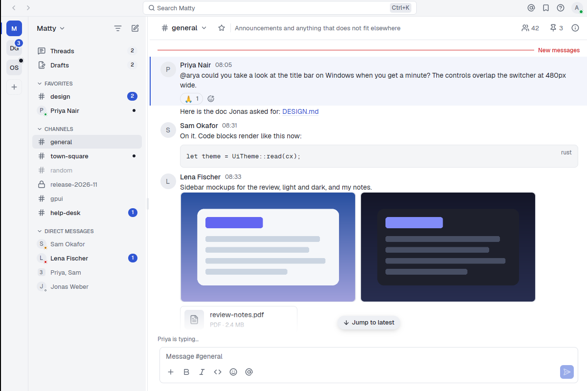
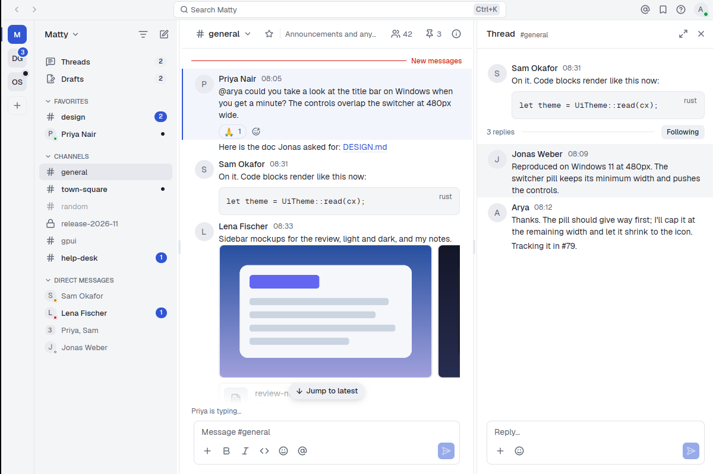
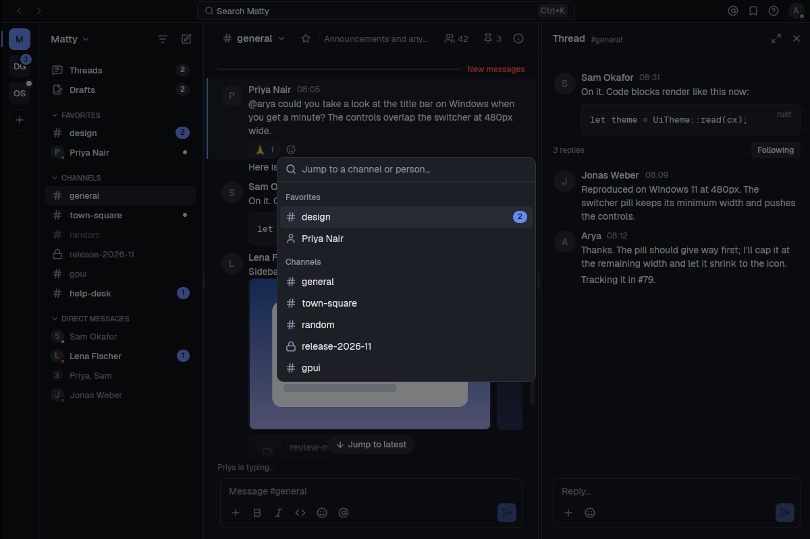
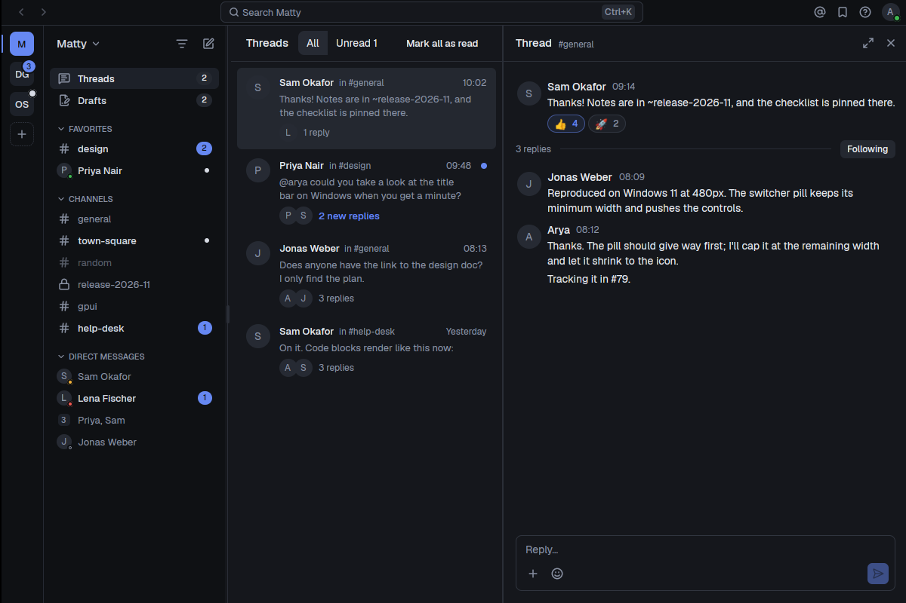
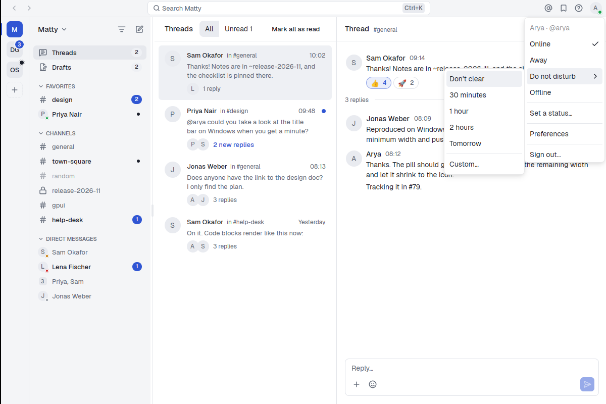
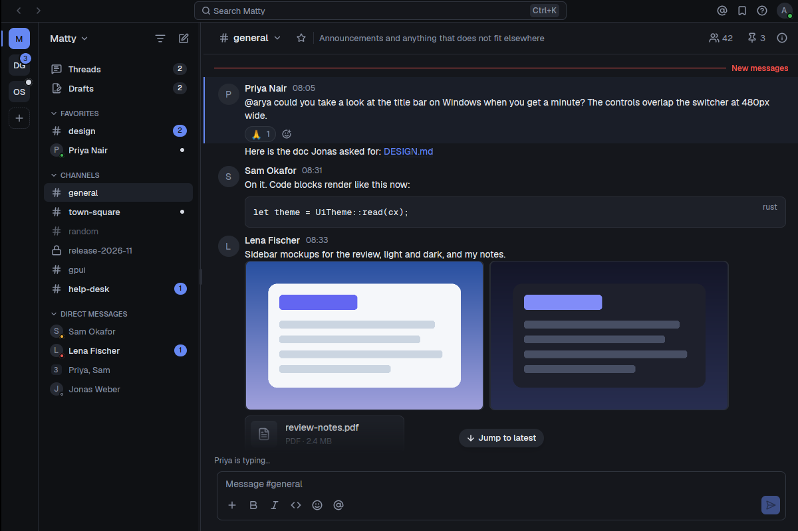
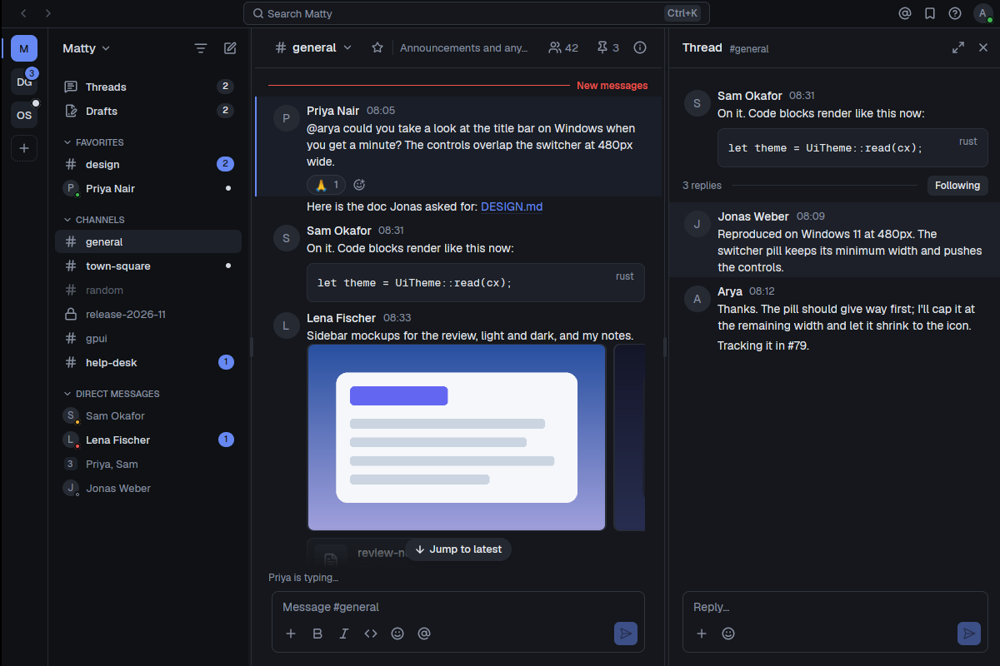
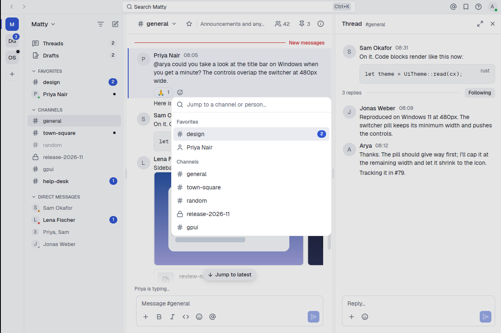
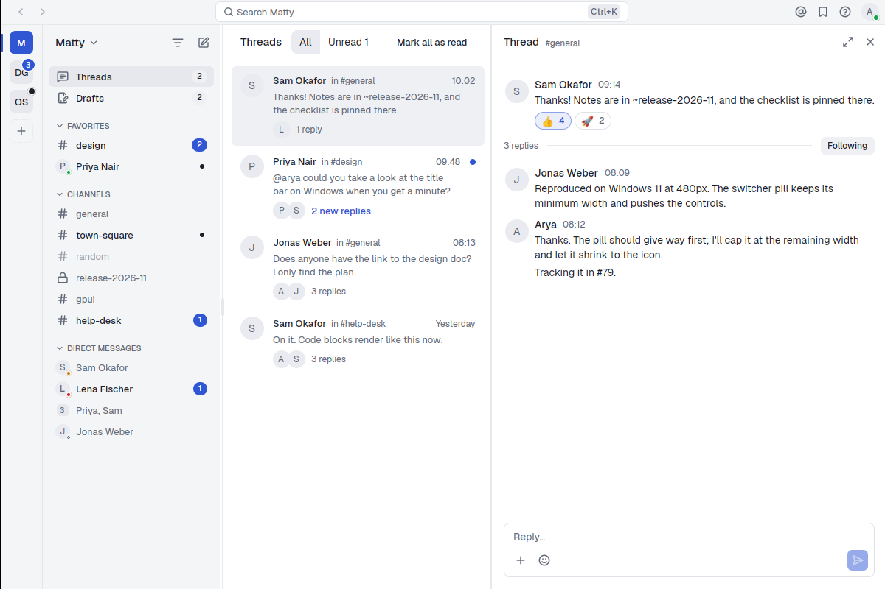
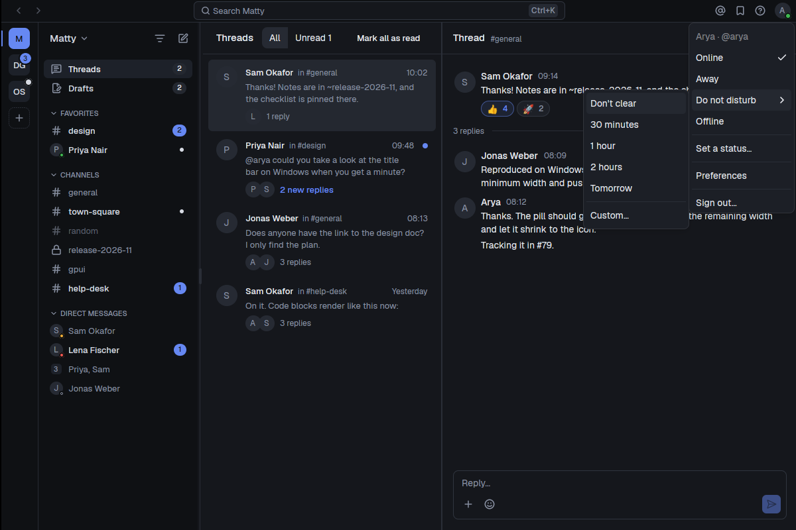

# Matty

A native [Mattermost](https://mattermost.com) desktop client, written in Rust
on [GPUI](https://www.gpui.rs) with the [gpuicn](https://github.com/devaryakjha/gpuicn)
component library. The goal is a client that opens instantly, switches
channels without a spinner, and stays usable offline.

> **Status: early alpha.** Matty is under active development toward its first
> milestone (M1). There are no releases yet: build it from source (see
> [Install](#install) for what releases will look like). The plan of
> record is [docs/PLAN.md](docs/PLAN.md), and work is tracked in
> [GitHub issues](https://github.com/devaryakjha/matty/issues).



## Screenshots

| | |
| --- | --- |
|  |  |
| Threads open beside the channel, with Follow and replies in place. | The quick switcher jumps to any channel or person. |
|  |  |
| Collapsed reply threads get their own view, with an Unread filter. | Set your status, with Do not disturb for a while or until a time. |

<details>
<summary>The same views in the other theme</summary>

| | |
| --- | --- |
|  |  |
|  |  |
|  | |

</details>

All screenshots are taken from the preview fixtures (`MATTY_PREVIEW=1`, see
below) at 1200×800.

## What works today

- **Sign in** with a password or single sign-on (GitLab, Google, Office 365,
  OpenID, SAML). Your teams sit in the team rail.
- **Sidebar** with your categories, favorites, unread and mention badges, an
  Unreads filter, and direct and group messages with presence dots.
- **Messages:** Markdown, code blocks, reactions, file and image attachments,
  uploads and downloads, edit and delete, pin and save, copy text or a link,
  and "Mark as unread". Messages are grouped and divided by day, and a
  "New messages" line marks where you left off.
- **Threads:** collapsed reply threads, the Threads view, following, and a
  thread pane next to the channel.
- **Finding things:** search, the quick switcher, recent mentions, saved and
  pinned messages, and drafts.
- **Offline first:** channels you've opened read from a local cache, and
  messages you send while offline wait in an outbox and go out in order
  when you reconnect.
- **Status:** online, away, offline, and Do not disturb with a duration.
- **Preferences:** theme (light, dark, system), text size, 12 or 24-hour
  clock, Enter or Ctrl+Enter to send, standard or compact messages, mention
  keywords, and reduced motion.
- **Keyboard and screen readers:** shortcuts for navigation and message
  actions, one tab stop per list, and accessible names on every control.

Desktop notifications, the image viewer, link previews and signed release
builds are next. See the [M1 milestones](docs/PLAN.md) for the full list.

## Install

Matty is an unofficial client for Mattermost, not made or endorsed by
Mattermost, Inc. Releases are published on
[GitHub Releases](https://github.com/devaryakjha/matty/releases); the first
one comes with the M1 beta.

**macOS 13 or later, Apple silicon or Intel.** Download `Matty-<version>.dmg`
from the latest release, open it and drag Matty to Applications. Each release
lists the files' SHA-256 checksums in `SHA256SUMS`:

```sh
shasum -a 256 -c SHA256SUMS --ignore-missing
```

Or install with [Homebrew](https://brew.sh):

```sh
brew install --cask devaryakjha/matty/matty
```

Matty updates itself, so `brew upgrade` leaves it alone unless you pass
`--greedy`. `brew uninstall --zap --cask matty` also removes its settings,
cache and logs. Your sign-in tokens stay in the keychain under "Matty" until
you sign out or delete them in Keychain Access.

Windows and Linux builds come later (M2); until then, build from source.

### Supported servers

The current Mattermost release and the extended support releases still
getting patches. CI tests against Mattermost 12.0, 11.7, 10.11 and 10.5.

### Known limitations

- Webapp plugins (Boards, Playbooks and other plugin UIs) can't run in a
  native client. Their posts show a card with "Open in browser".
- Calls isn't supported; call posts open in the browser.
- The System Console isn't in Matty; use the web app.

### Reporting problems

[Open an issue](https://github.com/devaryakjha/matty/issues/new) with your
Matty version (`/Applications/Matty.app/Contents/MacOS/matty --version`),
your macOS version and your Mattermost server version. Preferences has a
button that opens the logs folder. Logs leave out tokens and message text
by default, but look before you attach one.

## Building

Matty builds with the Rust toolchain pinned in `rust-toolchain.toml`
(rustup installs it on first build).

```sh
cargo run -p matty
```

macOS is the primary platform. Linux builds and runs too, and needs the X11,
Wayland and fontconfig headers (on Debian or Ubuntu:
`libxkbcommon-dev libxkbcommon-x11-dev libwayland-dev libfontconfig-dev`).

To try the interface without a server, run it with the preview fixtures:

```sh
MATTY_PREVIEW=1 cargo run -p matty
```

On macOS, notifications only show from an app bundle. `scripts/dev-bundle`
builds an ad-hoc signed `target/Matty Dev.app` with its own bundle id and
URL schemes, so it can sit next to a release install:

```sh
scripts/dev-bundle && open "target/Matty Dev.app"
```

`scripts/release-bundle` builds the universal release bundle,
`target/dist/Matty.app`, for Apple silicon and Intel. It needs both Rust
targets: `rustup target add aarch64-apple-darwin x86_64-apple-darwin`.

## Development

- [docs/PLAN.md](docs/PLAN.md): goals, milestones and architecture.
- [docs/DESIGN.md](docs/DESIGN.md): the visual design and its rules.
- [docs/dev-server.md](docs/dev-server.md): a local Mattermost server in
  Docker for development and integration tests.
- [CONTRIBUTING.md](CONTRIBUTING.md): how pull requests work here, including
  the screenshot rule for visible changes.

The workspace is split into crates: `matty-api` (REST and WebSocket client),
`matty-store` (SQLite cache), `matty-sync` (the sync engine, with no GPUI
dependency), `matty-markdown`, `matty-notify` (notification policy and
platform backends) and `matty-app` (the GPUI interface). `matty` is the
binary.

## License

[MIT](LICENSE). Matty is not affiliated with or endorsed by Mattermost, Inc.
