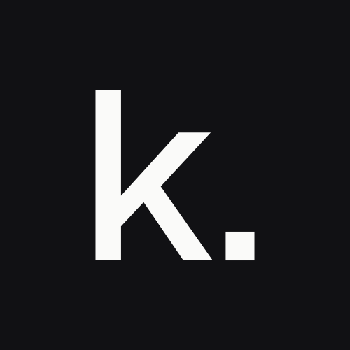

# Karya Labs brand

**कार्य** (kārya) means work: a task carried through to the end. The mark is a lowercase **k** and a full stop: the work, and the point where it's done. It also stands for Kumar Arya.

## Use

- Ink on paper, or paper on ink. No other colours, no stretching, no rotating.
- Keep clear space around the mark at least twice the height of the full stop.
- At 24 px and below, use the `-small` mark. It is drawn heavier so it doesn't fill in.

| Colour | Hex | Use |
| --- | --- | --- |
| Ink | `#111114` | Mark, text |
| Paper | `#FAFAF9` | Backgrounds |
| Stone | `#8A8A90` | Secondary text only, such as "LABS" |

Typeface: [Geist](https://fonts.google.com/specimen/Geist). The primary wordmark is **KARYA LABS** in Geist Regular capitals, letter-spaced 0.22 em. The secondary wordmark is **karya labs** in Geist Medium lowercase. Every SVG has its text converted to outlines.

## Files

| Path | What |
| --- | --- |
| `avatar/` | Org avatar. Upload `karya-avatar-dark-500.png` to GitHub. |
| `favicon/` | `favicon.svg` (adapts to dark mode), `favicon.ico`, PNGs, `apple-touch-icon.png` |
| `social/` | 1280 × 640 social preview cards, dark and light |
| `mark/` | The mark alone, ink and white, regular and small |
| `lockup/` | The mark with the wordmark, capitals and lowercase |
| `src/` | `final.py` draws everything (needs fonttools, uharfbuzz and Geist 400/500/700 TTFs; Playwright for PNGs) |
